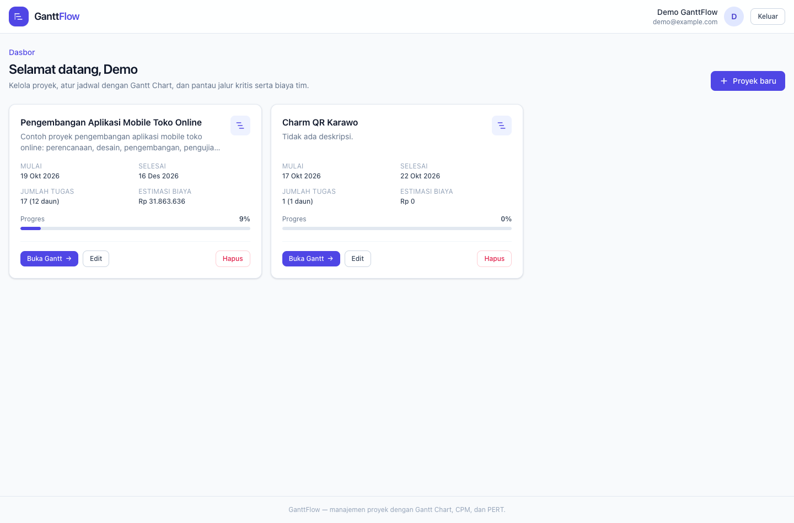
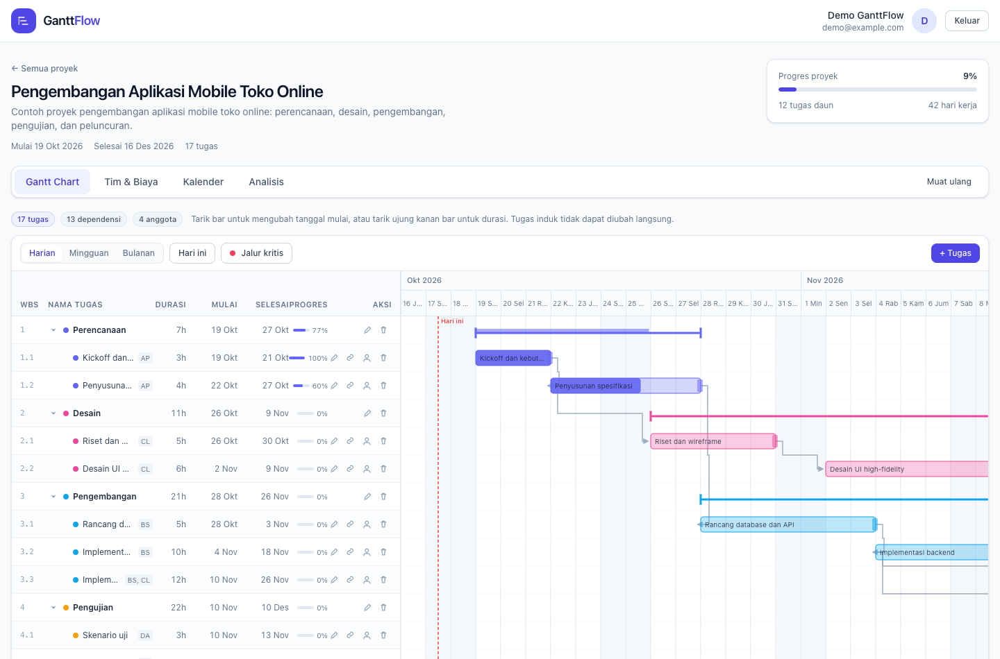
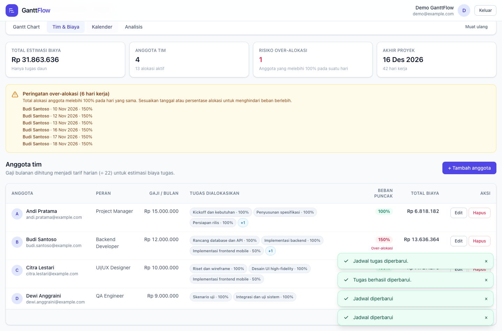
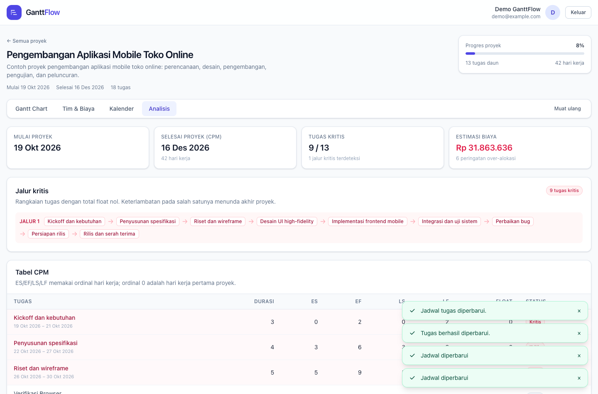

# GanttFlow — Manajemen Proyek Berbasis Gantt Chart

GanttFlow adalah aplikasi web manajemen proyek multi-pengguna berbahasa Indonesia. Aplikasi ini
menggabungkan Gantt Chart interaktif, penjadwalan otomatis berbasis hari kerja, dependensi FS/SS,
kalender kerja, alokasi tim dan biaya, serta analisis Critical Path Method (CPM) dan PERT.

Seluruh perhitungan jadwal berada di paket TypeScript `shared` yang dipakai bersama oleh server dan
client sehingga pratinjau di browser dan hasil akhir di server memakai mesin yang sama.

- Frontend: <http://localhost:5173>
- API: <http://localhost:3001>
- Health check: <http://localhost:3001/api/health>

## Fitur yang tersedia

- Registrasi, login JWT, logout, dan isolasi data per pemilik proyek.
- CRUD proyek beserta konfirmasi hapus dan penghapusan data turunan.
- CRUD tugas dengan hierarki maksimal tiga level, WBS otomatis, dan summary task terhitung.
- Gantt Chart SVG: zoom harian/mingguan/bulanan, bar progres, bracket summary task, panah FS/SS,
  garis hari ini, arsiran akhir pekan/hari libur, tooltip, dan sorotan jalur kritis.
- Drag bar untuk memindahkan tanggal mulai dan resize ujung kanan untuk mengubah durasi, dengan
  pratinjau memakai mesin `shared` sebelum disimpan.
- Penjadwalan ulang otomatis setelah perubahan tugas, dependensi, kalender, atau hari libur.
- Manajemen anggota tim, alokasi per tugas, estimasi biaya, dan peringatan over-alokasi.
- Kalender kerja: pilihan akhir pekan, hari libur khusus, dan kalender mini bulanan.
- Analisis CPM (ES/EF/LS/LF/float/status kritis), daftar jalur kritis, diagram PERT SVG dengan zoom,
  serta ringkasan biaya dan beban kerja.
- Loading state, empty state, error state, toast, dialog konfirmasi, validasi form, dan layout responsif.

## Tangkapan layar

Tangkapan layar dihasilkan otomatis oleh `npm run verify:browser` pada 2026-10-17 (viewport 1440×950)
dengan data seed.

### Dasbor proyek



### Gantt Chart



### Tim dan biaya



### Analisis CPM dan PERT



## Teknologi

| Lapisan | Teknologi |
|---|---|
| Frontend | React 18, TypeScript, Vite 5, React Router 6 |
| Styling | Tailwind CSS 3 |
| Server state & form | TanStack Query 5, react-hook-form, Zod |
| Backend | Node.js, Express 4, TypeScript, tsx |
| Autentikasi | jsonwebtoken, bcryptjs |
| Keamanan | helmet, cors, express-rate-limit |
| Database | SQLite |
| ORM | Prisma 6 |
| Mesin bersama | paket workspace `@gantt/shared` |
| Visualisasi | SVG buatan sendiri (Gantt dan PERT) |
| Test | Vitest, Supertest, Testing Library |
| Monorepo | npm workspaces, concurrently |

## Struktur folder

```text
gantt-project-app/
├── package.json                 # script root dan workspaces
├── tsconfig.base.json
├── .env.example                 # contoh environment (salin ke server/.env)
├── README.md
├── PROGRESS.md                  # catatan implementasi dan hasil verifikasi
├── docs/screenshots/            # screenshot hasil verifikasi browser
├── scripts/browser-verify.mjs   # verifikasi end-to-end dengan Chrome terpasang
├── shared/
│   └── src/                     # tanggal, kalender, scheduler, CPM, PERT, biaya, schema, tipe
│       ├── dates.ts
│       ├── calendar.ts
│       ├── scheduler.ts
│       ├── cpm.ts
│       ├── pert.ts
│       ├── cost.ts
│       ├── tree.ts
│       ├── metrics.ts
│       ├── schemas.ts
│       └── *.test.ts
├── server/
│   ├── prisma/
│   │   ├── schema.prisma
│   │   ├── migrations/
│   │   └── seed.ts
│   └── src/
│       ├── index.ts, app.ts, config.ts, db.ts, http.ts
│       ├── middleware/{auth,error,validate}.ts
│       ├── routes/{auth,projects,tasks,dependencies,resources,calendar}.ts
│       ├── services/{access,snapshot,recompute,analysis}.ts
│       └── tests/{globalSetup.ts,api.test.ts}
└── client/
    ├── index.html, vite.config.ts, tailwind.config.js
    └── src/
        ├── api/, hooks/, lib/, pages/, styles/
        ├── components/{gantt,pert,tasks,team,calendar,projects,layout,ui}/
        └── test/
```

## Prasyarat

- Node.js 20 atau lebih baru (diuji dengan Node 24.21.0).
- npm 10 atau lebih baru (diuji dengan npm 11.19.0).
- Git.
- Google Chrome terpasang hanya jika ingin menjalankan verifikasi browser.

## Instalasi dari keadaan bersih

```bash
npm install
cp .env.example server/.env
# Edit server/.env, isi JWT_SECRET dengan nilai acak:
#   openssl rand -hex 32
npm run db:migrate
npm run db:seed
npm run dev
```

`npm install` dipanggil dari root dan memasang seluruh workspace. Proses `postinstall` menjalankan
`prisma generate`.

`DATABASE_URL` relatif terhadap folder schema Prisma (`server/prisma`), sehingga `file:./dev.db`
berarti `server/prisma/dev.db`.

### Konfigurasi environment

| Variabel | Wajib | Contoh | Keterangan |
|---|---|---|---|
| `DATABASE_URL` | ya | `file:./dev.db` | Lokasi SQLite relatif terhadap `server/prisma`. |
| `JWT_SECRET` | ya | hasil `openssl rand -hex 32` | Minimal 32 karakter. Server menolak start jika kosong, terlalu pendek, atau masih memakai nilai contoh. |
| `PORT` | tidak | `3001` | Port API. |
| `NODE_ENV` | tidak | `development` | `production` akan menyembunyikan log internal. |
| `CORS_ORIGIN` | tidak | `http://localhost:5173` | Daftar origin dipisah koma. |
| `JWT_EXPIRES_IN` | tidak | `7d` | Masa berlaku token. |

File `server/.env` tidak pernah di-commit. Root `.env.example` berisi placeholder, bukan rahasia nyata.

## Migrasi dan seed

```bash
npm run db:migrate   # prisma migrate dev, membuat/menerapkan migration
npm run db:seed      # seed demo; idempoten
npm run db:reset     # PERINGATAN: menghapus database development lalu menerapkan ulang migration
```

`npm run db:reset` **menghapus seluruh data pada `server/prisma/dev.db`**. Perintah ini hanya menyentuh
database lokal tersebut dan tidak menyentuh database test (`server/prisma/test.db`). Jalankan seed
lagi setelah reset bila membutuhkan data demo.

Seed membuat akun demo dan proyek contoh:

- Email: `demo@example.com`
- Password: `Demo12345`
- Proyek: **Pengembangan Aplikasi Mobile Toko Online** (17 tugas, 13 dependensi, 4 anggota, 2 hari libur).

Seed menghapus dan membuat ulang proyek demo milik akun demo pada setiap eksekusi sehingga hasilnya
konsisten. **Akun demo hanya untuk development/demo lokal, bukan untuk production.**

## Menjalankan aplikasi

```bash
npm run dev
```

Perintah ini membangun `shared` terlebih dahulu, lalu menjalankan:

- Express + tsx watch di `http://localhost:3001`
- Vite di `http://localhost:5173` dengan proxy `/api` ke port 3001

Buka `http://localhost:5173`, login, lalu buka proyek seed.

### Build dan mode production lokal

```bash
npm run build
npm run start -w @gantt/server       # API production dari server/dist, port 3001
npm run preview -w @gantt/client     # client hasil build di port 4173 (proxy /api)
```

Jalankan perintah server dari workspace (`npm run ... -w @gantt/server`) agar `server/.env` terbaca,
karena `dotenv` membaca `.env` dari direktori kerja.

## Pengujian

```bash
npm run typecheck    # shared + server + client
npm test             # seluruh unit, integration, dan component test
npm run build        # build shared, server, dan client
```

Hasil terakhir (2026-10-17):

- `shared`: 62 test lulus (8 file).
- `server`: 22 integration test lulus (SQLite test terpisah).
- `client`: 14 component test lulus (4 file).
- Total: **98 test lulus, 0 gagal**.

Test server memakai `server/prisma/test.db` yang dibuat ulang `prisma db push --force-reset` pada
global setup; database development tidak disentuh.

### Verifikasi browser nyata

Dengan aplikasi dev berjalan dan seed tersedia:

```bash
npm run verify:browser
```

Skrip memakai `playwright-core` dan Google Chrome yang terpasang (`channel: 'chrome'`), tanpa
mengunduh browser Playwright. Cakupan: login, buka proyek seed, buat tugas, dependensi FS, resize,
drag, edit durasi, tambah/hapus hari libur, halaman Tim, halaman Analisis, refresh, logout, proteksi
rute, error runtime, dan error console. Hasil terakhir: **19/19 pemeriksaan lolos**; screenshot
ditulis ke `docs/screenshots/`.

## Ringkasan REST API

Semua respons JSON. Selain endpoint publik, header `Authorization: Bearer <token>` wajib.

| Method | Path | Fungsi |
|---|---|---|
| GET | `/api/health` | Health check server dan database |
| POST | `/api/auth/register` | Registrasi |
| POST | `/api/auth/login` | Login |
| GET | `/api/auth/me` | Profil pengguna aktif |
| GET | `/api/projects` | Daftar proyek milik pengguna beserta metrik |
| POST | `/api/projects` | Membuat proyek (respons snapshot) |
| GET | `/api/projects/:id` | Snapshot proyek |
| PATCH | `/api/projects/:id` | Ubah nama/deskripsi/tanggal mulai |
| DELETE | `/api/projects/:id` | Hapus proyek dan seluruh turunannya |
| POST | `/api/projects/:id/tasks` | Buat tugas |
| PATCH | `/api/tasks/:id` | Edit tugas |
| DELETE | `/api/tasks/:id` | Hapus tugas, anak, dependensi, dan alokasi |
| POST | `/api/tasks/:id/move` | Ubah induk dan posisi |
| POST | `/api/tasks/:id/dependencies` | Buat dependensi (tugas `:id` adalah penerus) |
| PATCH | `/api/dependencies/:id` | Ubah tipe/lag |
| DELETE | `/api/dependencies/:id` | Hapus dependensi |
| GET | `/api/projects/:id/resources` | Daftar anggota |
| POST | `/api/projects/:id/resources` | Tambah anggota |
| PATCH | `/api/resources/:id` | Edit anggota |
| DELETE | `/api/resources/:id` | Hapus anggota dan alokasinya |
| POST | `/api/tasks/:id/assignments` | Alokasikan anggota ke tugas daun |
| PATCH | `/api/assignments/:id` | Ubah persentase alokasi |
| DELETE | `/api/assignments/:id` | Hapus alokasi |
| PUT | `/api/projects/:id/calendar` | Ubah hari akhir pekan |
| POST | `/api/projects/:id/holidays` | Tambah hari libur |
| DELETE | `/api/holidays/:id` | Hapus hari libur |
| GET | `/api/projects/:id/analysis` | CPM, PERT, biaya, dan beban kerja |

Bentuk respons utama:

- Autentikasi: `{ "token": "...", "user": { "id", "name", "email", "createdAt" } }`.
- Snapshot proyek: `{ "project": { ..., "holidays": [] }, "tasks": [], "dependencies": [], "resources": [], "assignments": [], "metrics": { ... } }`.
- Mutasi yang memengaruhi jadwal: `{ "tasks": [...] }` berisi data terbaru dari server.
- Kalender/hari libur: `{ "project": { ... }, "tasks": [...] }`.
- Error konsisten:

```json
{
  "error": {
    "code": "CYCLE_DETECTED",
    "message": "Dependensi membentuk siklus.",
    "details": {}
  }
}
```

Status yang dipakai: 400 (input tidak valid), 401 (belum terautentikasi/token invalid), 404 (tidak
ditemukan atau bukan milik pengguna), 409 (konflik relasi), 422 (validasi bisnis), 429 (rate limit),
500 (kesalahan internal tanpa stack trace).

## Mesin penjadwalan, CPM, dan PERT

### Kalender dan tanggal

- Tanggal disimpan sebagai string ISO `YYYY-MM-DD` dan dihitung memakai `Date.UTC`, sehingga tidak
  bergeser karena zona waktu.
- `weekendDays` (0 = Minggu … 6 = Sabtu) disimpan sebagai JSON string karena SQLite tidak memiliki
  tipe array. API selalu mengembalikannya sebagai array angka.
- `isWorkingDay`, `nextWorkingDay`, `shiftWorkingDays`, dan `workingDaysBetween` menjadi satu-satunya
  implementasi aturan hari kerja.
- Durasi tugas adalah jumlah hari kerja. `scheduledEnd = shiftWorkingDays(scheduledStart, durationDays - 1)`.

### Dependensi

- **FS**: `earliest = shiftWorkingDays(pred.scheduledEnd, 1 + lagDays)`.
- **SS**: `earliest = shiftWorkingDays(pred.scheduledStart, lagDays)`.
- Lag dihitung dalam hari kerja dan boleh negatif.
- `scheduledStart = nextWorkingDay(max(task.startDate, semua batas pendahulu))`.
- Dependensi hanya boleh antar tugas daun. Siklus, dependensi diri sendiri, duplikat, dan dependensi
  yang melibatkan tugas induk ditolak dengan 422.

### Summary task

Tugas induk dihitung dari anak-anaknya: mulai paling awal, selesai paling akhir, durasi hari kerja
inklusif, dan progres rata-rata berbobot durasi. Hanya nama, deskripsi, warna, dan prioritas yang dapat
diubah langsung. Menghapus tugas induk juga menghapus seluruh keturunannya.

### CPM

- Ordinal 0 adalah hari kerja pertama pada/setelah tanggal mulai proyek.
- Forward pass: `ES = ord(start)`, `EF = ES + durasi - 1`, `PE = max(EF)`.
- Backward pass memakai batas penerus FS/SS dan lag; `LS = LF - durasi + 1`, `float = LS - ES`.
- Tugas kritis adalah tugas dengan float 0. Float negatif tidak disembunyikan; UI menampilkan peringatan.
- Jalur kritis dihitung dari sisi dependensi yang mengikat dan diurutkan berdasarkan ES.

### PERT

- `te = (o + 4m + p) / 6`, `variance = ((p - o) / 6)²`.
- Estimasi valid bila `1 ≤ o ≤ m ≤ p`.
- Nilai proyek hanya tampil jika seluruh tugas pada jalur kritis utama memiliki estimasi lengkap.
- Variansi dijumlahkan sepanjang jalur kritis utama dengan asumsi aktivitas independen.

### Biaya dan beban kerja

- `dailyRate = gaji bulanan / 22`.
- `biaya tugas = Σ(dailyRate × durasi × alokasi%)`, hanya untuk tugas daun agar summary tidak menggandakan biaya.
- Total biaya ditampilkan dengan `Intl.NumberFormat("id-ID", { style: "currency", currency: "IDR" })`;
  pembulatan hanya dilakukan saat menampilkan.
- Over-alokasi dihitung per resource per hari kerja aktual; total > 100% memunculkan peringatan.

## Asumsi implementasi

1. Tanggal proyek adalah tanggal kalender, bukan timestamp; semua perhitungan memakai UTC.
2. `weekendDays` disimpan sebagai JSON string dan divalidasi minimal ada satu hari kerja.
3. Menghapus tugas induk menghapus seluruh keturunannya (dikonfirmasi di UI).
4. Summary task mengabaikan `durationDays`/`startDate` tersimpan dan selalu dihitung dari anak.
5. CPM hanya memakai tugas daun; ordinal dihitung dari tanggal mulai proyek.
6. PERT proyek memakai jalur kritis utama (jalur pertama yang terdeteksi).
7. Biaya memakai 22 hari kerja per bulan dan tidak dibulatkan sebelum ditampilkan.
8. Saat drag, geseran pointer dibulatkan ke hari kalender lalu di-snap ke hari kerja; durasi resize
   dihitung dari rentang hari kerja sehingga melepas pointer pada akhir pekan tidak menambah durasi.
9. JWT disimpan di `localStorage` (bukan cookie httpOnly). Respons 401 otomatis menghapus sesi dan
   mengarahkan pengguna ke halaman login.
10. Rate limit login/register 50 percobaan per 15 menit per IP (dinaikkan pada lingkungan test).
11. Seed demo hanya mengisi estimasi PERT untuk satu tugas sesuai spesifikasi, sehingga estimasi PERT
    tingkat proyek pada data seed sengaja tampil sebagai “belum lengkap”.

## Batasan yang masih ada

- Tidak ada kolaborasi real-time/WebSocket, notifikasi email, ekspor PDF, aplikasi native,
  multi-bahasa, atau deployment cloud otomatis.
- SQLite dan satu proses Express cocok untuk penggunaan lokal/kelas; belum dioptimalkan untuk
  konkurensi tinggi.
- Daftar proyek belum memakai pagination.
- Interaksi drag/resize diuji di Chrome desktop; gestur sentuh belum diuji terpisah.
- PERT memakai jalur kritis utama, bukan seluruh kemungkinan jalur kritis, saat menjumlahkan variansi.
- Push ke GitHub belum dilakukan karena URL repository belum diberikan.

## Pemecahan masalah

| Masalah | Solusi |
|---|---|
| Server gagal start: `JWT_SECRET kosong/terlalu pendek` | Isi `server/.env` dengan `openssl rand -hex 32`. |
| `Can't reach database server` / tabel tidak ada | Jalankan `npm run db:migrate` dari root. |
| Perubahan schema Prisma tidak dikenali | `npm run db:generate`, lalu restart server. |
| Port 3001/5173 sudah dipakai | Hentikan proses lain atau ubah `PORT`/port Vite. Sisa dev server dari lokasi folder lama juga bisa memegang port: `lsof -ti:3001,5173 | xargs kill`. |
| Folder proyek dipindah atau di-rename, lalu server gagal start / `PrismaClientInitializationError` | Prisma Client menyimpan path absolut saat `prisma generate`. Hentikan dev server, jalankan `npm run db:generate`, hapus cache Vite (`rm -rf client/node_modules/.vite server/node_modules/.vite`), lalu `npm run dev`. |
| Login gagal setelah mengganti password seed | Jalankan `npm run db:seed` untuk menyiapkan ulang akun demo. |
| Data ingin direset total | `npm run db:reset && npm run db:seed` (menghapus data lokal). |
| Verifikasi browser gagal: Chrome tidak ditemukan | Pasang Google Chrome, atau ubah opsi `channel` pada `scripts/browser-verify.mjs`. |
| Token kedaluwarsa | Login ulang; aplikasi otomatis kembali ke halaman login saat menerima 401. |

## Lisensi

Proyek contoh untuk pembelajaran dan pengembangan lokal. Tidak disertakan lisensi khusus.
